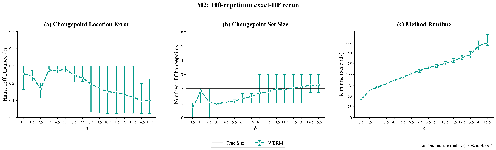
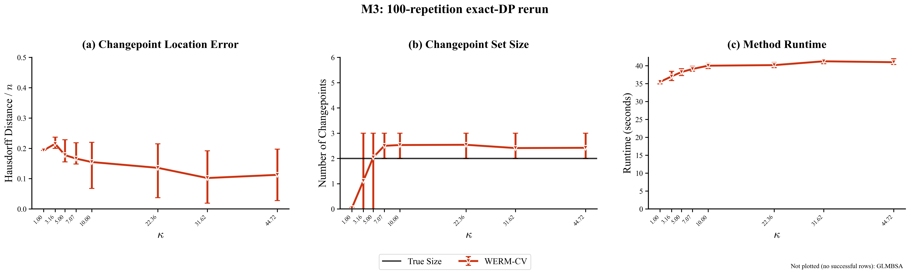

# WER-8: M2 and M3, 100-repetition exact-DP rerun

Status: **IN PROGRESS**. The accepted exact-DP production path is merged at base commit
`9b5d0036b71cb9b405775706817f65a720eceb24`. M2 and M3 are run sequentially;
the figures and numeric conclusions below will be filled from the complete row-level audit.

## Inspect

- [M2 summary](results/m2_summary.csv)
- [M3 summary](results/m3_summary.csv)
- [Per-repetition accounting](results/accounting.csv)
- [Compact run log](results/run_log.txt)





## Exact historical configuration

The source is the final experiment block in `M2 Comparison Experiments.ipynb` (cell
27) and `M3 Comparison Experiments.ipynb` (cell 13). Those notebooks are byte-for-byte
identical to the copies in the read-only `/scratch/ga442/Weighted-ERM` reference tree.
The corresponding archived 30-repetition pickle metadata was also checked. The new
drivers preserve the final grids, data models, estimator settings, tuning, metrics,
and plot palette. They change only the repetition count to 100, route WERM through the
accepted production DP, cap compute, make tasks resumable, and expose failures.

The historical notebooks seeded NumPy once before dispatching 36 parallel jobs. That
does not define independent per-repetition streams and cannot be resumed reliably.
The rerun therefore derives each seed deterministically as
`SeedSequence([42, workflow code, parameter index, repetition])`. M3's inner CV worker
count is one rather than three to prevent nested parallelism; its folds and tuning are
unchanged.

The final notebook blocks contain no implemented theoretical-prediction curve, so no
theory curve is invented here. M3's `sqrt(0.6)` value is retained in metadata but is
honestly labelled unused by the logistic response generator.

## Rerun

Run one experiment at a time, in the foreground:

```bash
.venv-phase1/bin/python scripts/rebuttal/M2_upsample.py --workers 4
.venv-phase1/bin/python scripts/rebuttal/M3_upsample.py --workers 4
.venv-phase1/bin/python scripts/rebuttal/plot_WER8.py
```

The effective worker count is printed and capped at the minimum of the request, 32,
and CPU affinity. Inner BLAS/OpenMP threads and inner CV parallelism are set to one.
Completed task files are skipped on rerun. Raw per-repetition JSON and readable task
logs live under the ignored, server-local
`rebuttal/WER-8-m2-m3-100/artifacts/` directory; each raw record links to its task log.

The historical competitors require `rpy2` plus unpublished or unavailable R packages.
Their dependency state is checked at run start. Missing methods are recorded as
`BLOCKED_DEPENDENCY` in every requested repetition and are never silently substituted.
An empty successful estimate has an undefined Hausdorff metric and is counted
separately; plots omit that metric value rather than treating it as zero.
