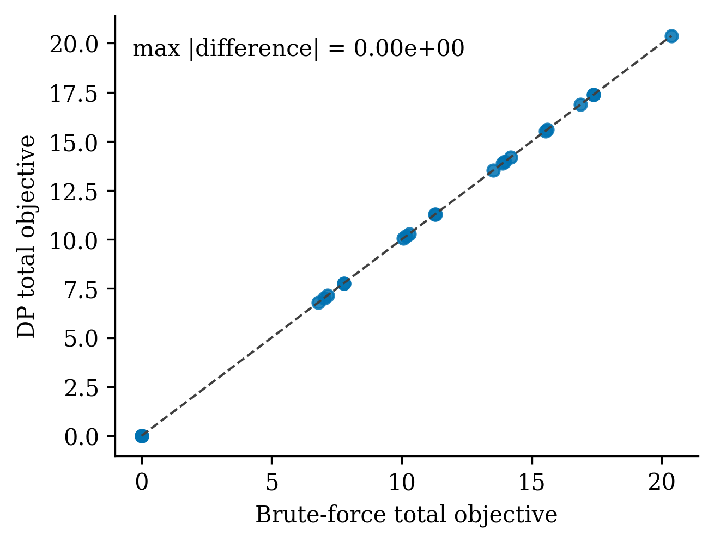
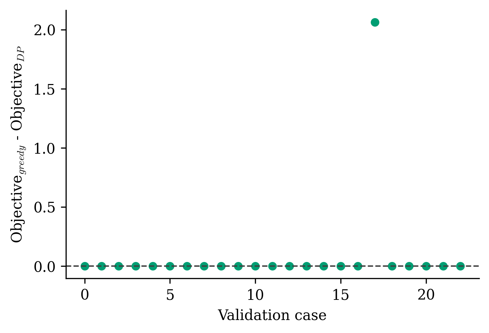
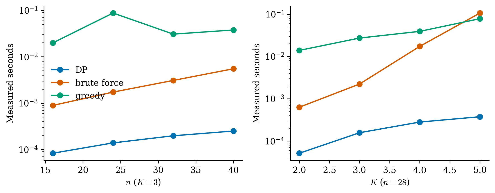
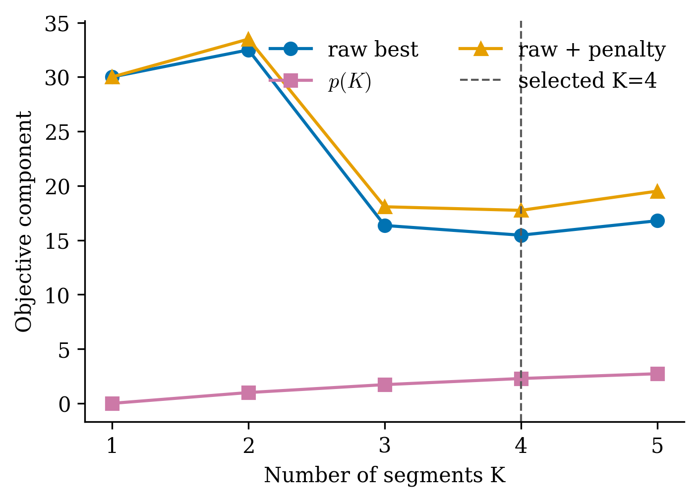
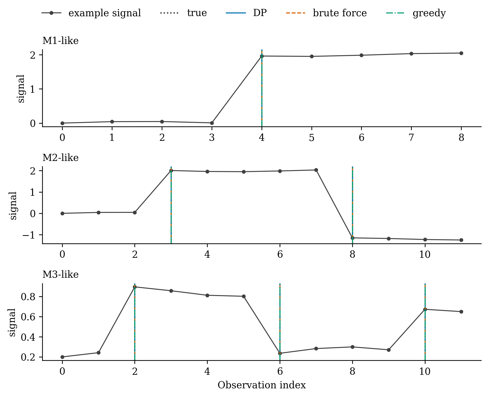

# Phase 1 exact-DP audit

**Overall status: PASS**

- DP/brute-force cases passed: **23 / 23**
- Maximum objective difference: **0.000e+00**
- Cases where DP was worse than greedy: **0**
- Focused tests: **46 passed**
- DP faster than brute force: **8 / 8** matched configurations (10.7x--283.9x)
- Exact rerun: `bash scripts/rebuttal/check_phase1.sh`

## How to inspect this PR in five minutes

1. Confirm all DP/brute-force rows pass in [cases.csv](results/cases.csv).
2. Confirm there are no negative greedy gaps beyond `1e-9`.
3. Look for points off the parity line and verify the marked K minimizes the penalized curve.
4. Inspect the three partition panels for indexing mistakes.
5. Scan the diff to confirm the production estimator dispatch is unchanged.

Measured repeats are in [timings.csv](results/timings.csv); command output is in
[test_output.txt](results/test_output.txt). The pre-change workflow record is in
[baseline.md](baseline.md).

## Historical reference tree

Artifacts not ported into this cleaner repository are checked read-only under
`/scratch/ga442/Weighted-ERM` (override with `WERM_HISTORICAL_ROOT`). The
Myocardial status is an archived-result `SMOKE`, based on structural validation
of the historical posterior pickle; it is not a fresh reproduction. Historical
FRED CSV/RData inputs were located but not rerun. No audit command writes to or
modifies the historical tree, and no historical result pickle is copied into
this repository. If that source tree is unavailable, Myocardial is `BLOCKED`.

The DP candidate matches the live brute-force convention: `Delta` constrains
adjacent internal changepoints but not endpoints, and K uses the first K columns
of Z. The requested log-binomial penalty uses K-1 changepoints. No manuscript
source is committed in this repository, so the formula was verified against the
issue specification; the legacy helper separately matches the live gamma formula.
The production/default search path is unchanged.
